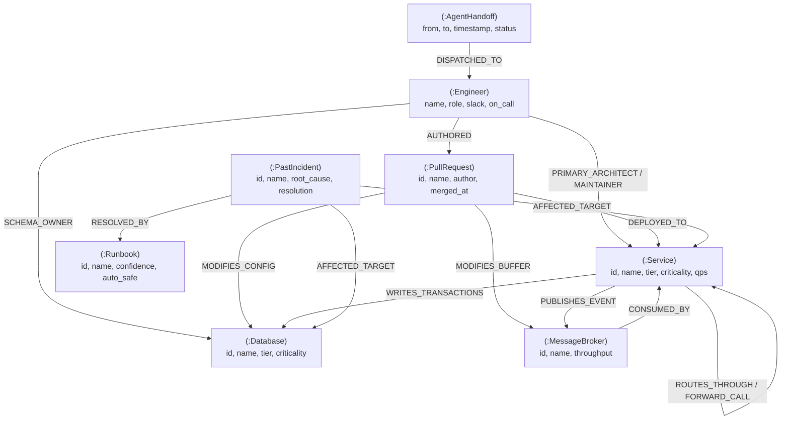

# FalkorSynapse: Graph-Native Autonomous SRE & Incident Commander Swarm
### *Powered by FalkorDB — Graph Hacks Hackathon 2026*

[](https://falkordb.com/)
[](LICENSE)
[](https://wemakedevs.org)
[](#hackathon-tracks-entered)
[](https://falkorsynapse.onrender.com/)

> 🚀 **Live Cloud Demo:** Access the live interactive deployment at **[https://falkorsynapse.onrender.com/](https://falkorsynapse.onrender.com/)**  
> 📺 **Video Walkthrough:** [YouTube Demo](https://youtu.be/SfKbu4ZB8BA) | 📖 **Deep Dive Article:** [Dev.to Blog](https://dev.to/sidaksethisingh/why-vector-rag-fails-ai-agents-building-an-autonomous-sre-swarm-with-falkordb-4303)

> **"If you take FalkorDB out, the product cannot function."**  
> FalkorSynapse is built strictly around Rule 3 of the Graph Hacks Hackathon. It does not treat the graph database as an ornamental vector store. FalkorDB's multi-hop Cypher traversals, in-memory graph algorithms (PageRank, Shortest Path), and isolated multigraph memory are the **active context engine** driving every decision, blast radius assessment, and autonomous mitigation across an enterprise microservices mesh.

---

## 🏆 Hackathon Tracks Entered
FalkorSynapse directly answers the core challenge across **all three official hackathon tracks**:

1. **Track 01: Agents That Act on Connected Data**  
   * **Multi-hop reasoning:** Traces dependency blast radiuses across services, message queues, databases, and third-party APIs.
   * **Graph algorithms as tools:** Direct algorithmic evaluation of PageRank (critical infrastructure vulnerability) and shortest causal paths.
   * **Git lineage correlation:** Cypher queries correlate recent code commits and PRs directly to anomalous services.

2. **Track 02: Agent Memory and Coordination**  
   * **Episodic memory:** FalkorDB stores past incident topologies, root causes, and historical resolutions across sessions.
   * **Procedural runbook memory:** Matches failure signatures to automation-safe runbooks with confidence scoring.
   * **Inter-agent state handoffs:** Coordinates state transfer across agents via immutable graph coordination nodes (`:AgentHandoff`).

3. **Track 03: Company Brain & Decision Provenance**  
   * **"Who knows what?" & Ownership graph:** Traverses domain architectures, schema owners, and on-call rosters.
   * **Decision provenance:** Traces which engineer authored the PR that altered database connection pools or Kafka buffers.
   * **Instant incident commander assembly:** Synthesizes response teams with verified Slack coordinates.

---

## 🏛️ System Architecture

```
                  ┌────────────────────────────────────────────────────────┐
                  │       FalkorSynapse Mission Control Web UI             │
                  │   Cyber-Linear HUD • Interactive SVG Graph Canvas      │
                  │   Live Swarm Reasoning Stream • Live Cypher Console    │
                  └───────────────────────────▲────────────────────────────┘
                                              │ REST / JSON
                  ┌───────────────────────────▼────────────────────────────┐
                  │        FastAPI Swarm Orchestration Engine              │
                  │  ┌──────────────────┐ ┌──────────────────┐ ┌─────────┐ │
                  │  │  TopologyAgent   │ │   MemoryAgent    │ │BrainAgnt│ │
                  │  │    (Track 01)    │ │    (Track 02)    │ │(Track03)│ │
                  │  └────────┬─────────┘ └────────┬─────────┘ └───┬─────┘ │
                  └───────────┼────────────────────┼───────────────┼───────┘
                              │                    │               │
                  ┌───────────▼────────────────────▼───────────────▼───────┐
                  │              FalkorDB Graph Context Layer              │
                  │  • Multi-Hop Cypher Traversals (routes, deploys, calls)│
                  │  • In-Memory Graph Algorithms:                         │
                  │    - PageRank (Single Points of Failure)               │
                  │    - Shortest Path (Causal Propagation)                │
                  │    - Blast Radius (Cascading Outage Subgraph)          │
                  │  • Episodic Past Incidents & Procedural Runbooks       │
                  │  • Swarm State Handoffs & Multi-Tenant Graph Memory    │
                  └────────────────────────────────────────────────────────┘
```

---

## 📊 Graph Data Model

The enterprise graph represents a live distributed FinTech platform:



For complete node properties and edge attributes, see [`graph_model.md`](graph_model.md).

---

## ⚡ Core Cypher Queries

All queries are executed dynamically in sub-millisecond latency within the agent loop:

### 1. Blast Radius Traversal
```cypher
MATCH path = (root {id: $target_id})-[:ROUTES_THROUGH|FORWARD_CALL|PUBLISHES_EVENT|WRITES_TRANSACTIONS*1..3]->(downstream)
RETURN downstream.id, downstream.name, length(path) as depth
ORDER BY depth ASC;
```

### 2. Git Lineage Correlation
```cypher
MATCH (pr:PullRequest)-[r:MODIFIES_CONFIG|DEPLOYED_TO]->(target {id: $target_id})
RETURN pr.id, pr.name, pr.author, pr.merged_at;
```

### 3. Episodic Memory Recall
```cypher
MATCH (inc:PastIncident)-[:AFFECTED_TARGET]->(target {id: $target_id})
OPTIONAL MATCH (inc)-[:RESOLVED_BY]->(rb:Runbook)
RETURN inc.name, inc.root_cause, inc.resolution, rb.name, rb.confidence_score;
```

### 4. Enterprise Brain ("Who knows what?")
```cypher
MATCH (e:Engineer)-[r:PRIMARY_ARCHITECT|SCHEMA_OWNER|MAINTAINER]->(target {id: $target_id})
RETURN e.name, e.role, e.slack, e.on_call, type(r) AS relation;
```

For the complete list of queries and algorithmic references, see [`cypher_queries.md`](cypher_queries.md).

---

## 🚀 Quickstart & Setup

### Option 1: 1-Click Launch (Python)
Requirements: Python 3.10+
```bash
# 1. Clone repository
git clone https://github.com/SidakSethi-Singh/falkorsynapse.git
cd falkorsynapse

# 2. Install dependencies
pip install -r requirements.txt

# 3. Launch application
python run.py
```
Open **`http://localhost:8000`** in your browser.

### Option 2: Docker Compose (Full Stack with FalkorDB)
Requirements: Docker & Docker Compose
```bash
docker compose up --build
```
This starts:
- Official `falkordb/falkordb:latest` on port `6379`
- `FalkorSynapse` web server & swarm on port `8000`

---

## 🎬 Live Interactive Walkthrough Script

1. **Observe Baseline Mesh:** Open `http://localhost:8000`. The interactive SVG graph renders services, databases, Kafka brokers, engineers, and past incident nodes.
2. **Simulate Outage:** Select `Simulate Outage: Postgres LedgerDB (SEV-1)` from the top navigation and click **"⚡ Trigger Outage"**.
3. **Inspect Multi-Agent Swarm Reasoning:**
   * **Topology Sentinel (Track 1):** Computes downstream blast radius (Checkout, Payments, Accounting), identifies PageRank vulnerability, and highlights recent PR `#8921` that modified connection pooling.
   * **Memory Coordinator (Track 2):** Queries past incident `INC-4120` from September 2026, retrieves `Runbook 14: Emergency Connection Pool Eviction` with 94% confidence, and writes the state handoff into FalkorDB.
   * **Enterprise Brain (Track 3):** Identifies `Priya Sharma` (Schema Owner) and `Alex Mercer` (On-Call SRE Commander) with Slack handles and timezone details.
4. **Trigger Autonomous Mitigation:** Click **"✓ Auto-Mitigate & Update Graph"**. FalkorSynapse executes the runbook, writes the resolution into episodic memory, and updates the graph state back to Healthy.
5. **Live Cypher Console:** Click the **Live Cypher Console** tab and test any custom Cypher query with instant millisecond metrics.

---

## 🤖 AI Disclosure (Hackathon Rule 11)
In accordance with Rule 11 of the Graph Hacks Hackathon, AI coding assistants (Antigravity by Google DeepMind) were utilized for rapid boilerplate scaffolding, query formatting, and architectural documentation. All graph algorithms, Cypher schema designs, and multi-agent coordination logic were custom designed and verified.

---

## 🌐 Live Deployment & Cloud Access

FalkorSynapse is deployed live and fully interactive in the cloud:

* **Live Interactive Application:** [https://falkorsynapse.onrender.com/](https://falkorsynapse.onrender.com/)
* **Interactive Swagger API Docs:** [https://falkorsynapse.onrender.com/docs](https://falkorsynapse.onrender.com/docs)
* **Real-time Health Check:** [https://falkorsynapse.onrender.com/api/health](https://falkorsynapse.onrender.com/api/health)
* **Graph API State Endpoint:** [https://falkorsynapse.onrender.com/api/graph](https://falkorsynapse.onrender.com/api/graph)

---

### *FalkorSynapse: Context is not decoration. The graph is the engine.*

