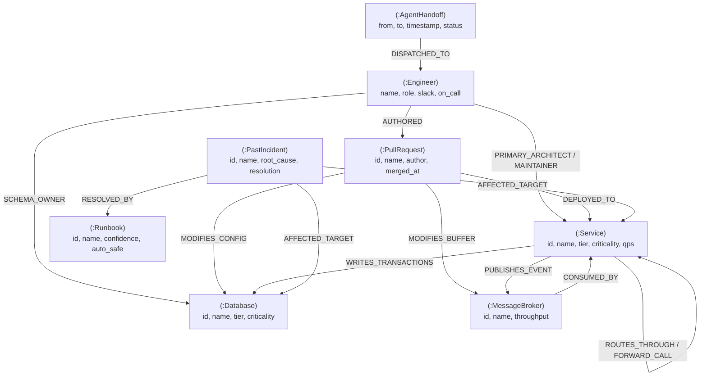

# FalkorSynapse: Graph Data Model Schema

This document details the **Graph Data Model** designed for **FalkorSynapse**, representing a distributed cloud infrastructure mesh, code deployment lineage, organizational ownership, and episodic memory stored natively in **FalkorDB**.

---

## 1. Schema Diagram (Mermaid)

---

## 2. Node Taxonomy

| Label | Description | Primary Properties |
|---|---|---|
| `:Service` | Microservice / API in the architecture | `id`, `name`, `tier`, `criticality`, `qps`, `status` |
| `:Database` | Data persistence store | `id`, `name`, `tier`, `criticality`, `connections`, `status` |
| `:MessageBroker`| Event bus or message queue | `id`, `name`, `throughput`, `criticality`, `status` |
| `:Cache` | Distributed caching layer | `id`, `name`, `hit_rate`, `criticality`, `status` |
| `:ExternalAPI` | Third-party vendor API (PSP, Auth) | `id`, `name`, `sla`, `status` |
| `:Engineer` | Team member or on-call commander | `id`, `name`, `role`, `slack`, `on_call`, `timezone` |
| `:PullRequest` | Deployed code change or hotfix | `id`, `name`, `author`, `merged_at`, `status` |
| `:PastIncident`| Historical outage record in episodic memory | `id`, `name`, `occurred`, `root_cause`, `resolution` |
| `:Runbook` | Validated procedural remediation recipe | `id`, `name`, `confidence_score`, `automation_safe` |
| `:AgentHandoff`| Swarm state transfer token | `id`, `from_agent`, `to_agent`, `timestamp`, `status` |

---

## 3. Relationship (Edge) Semantics

| Relationship Type | Source Node | Target Node | Purpose |
|---|---|---|---|
| `:ROUTES_THROUGH` | `:Service` | `:Service` | Ingress and reverse proxy routing |
| `:FORWARD_CALL` | `:Service` | `:Service` | Synchronous RPC/REST call dependency |
| `:PUBLISHES_EVENT`| `:Service` | `:MessageBroker`| Asynchronous event publishing |
| `:CONSUMED_BY` | `:MessageBroker` | `:Service` | Event-driven subscriber link |
| `:WRITES_TRANSACTIONS`| `:Service` | `:Database` | Relational/ledger write dependency |
| `:PRIMARY_ARCHITECT` | `:Engineer` | `:Service` | Organizational domain ownership |
| `:SCHEMA_OWNER` | `:Engineer` | `:Database` | Data model gatekeeper |
| `:DEPLOYED_TO` | `:PullRequest` | `:Service` | Continuous deployment lineage |
| `:MODIFIES_CONFIG` | `:PullRequest` | `:Database` | Schema/connection pool alteration |
| `:AFFECTED_TARGET` | `:PastIncident` | Component | Historical failure link |
| `:RESOLVED_BY` | `:PastIncident` | `:Runbook` | Validated resolution association |
| `:MITIGATED_BY` | Component | `:MitigationAction`| Dynamic resolution attribution |
